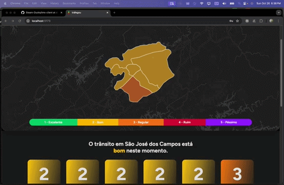
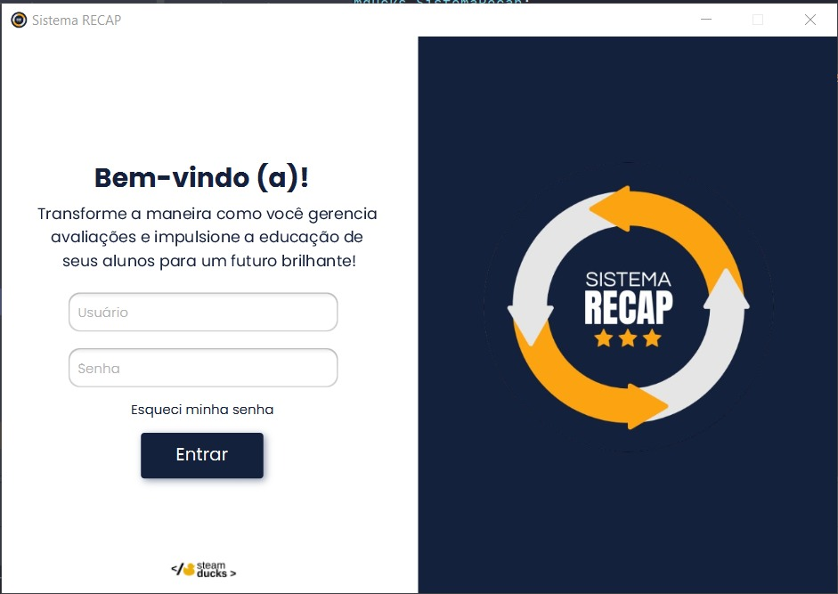
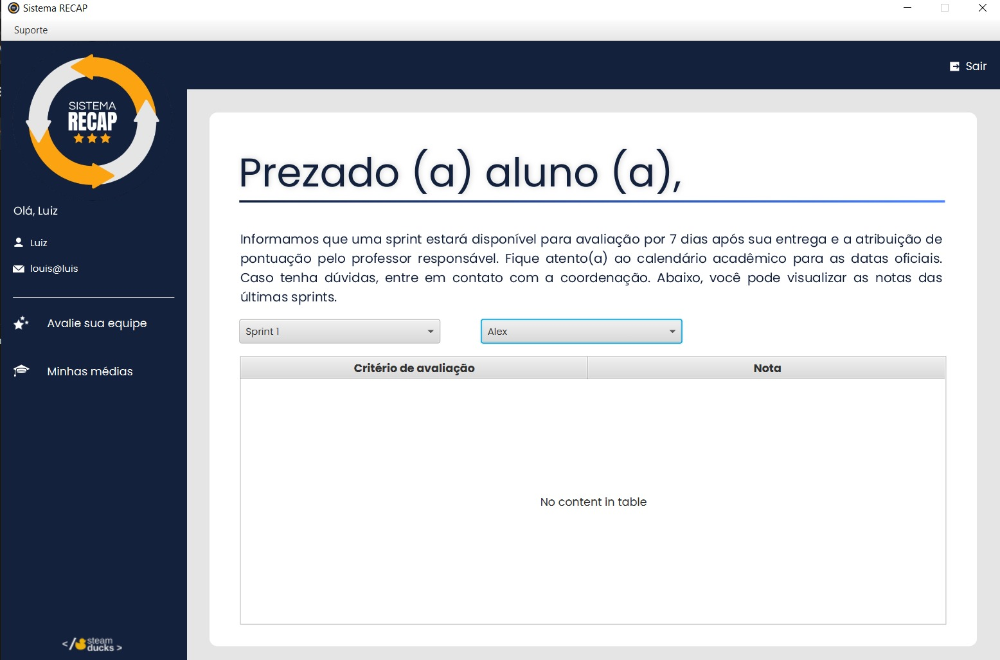
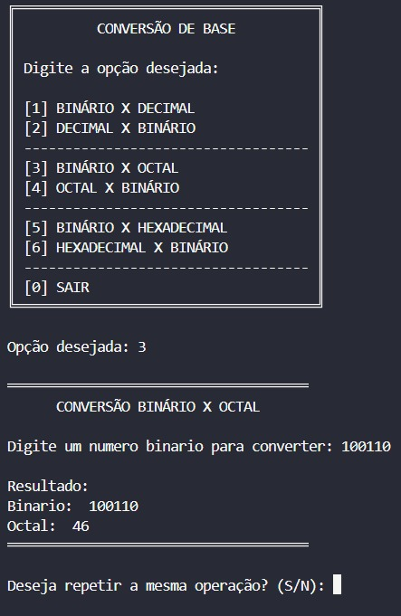

  

## Sobre mim

Olá! Sou a **Isabelly**, tenho 20 anos e estudo **Banco de Dados na FATEC Jessen Vidal**, em São José dos Campos. Estagiei em análise de dados na **Ericsson** e hoje sou **Analista de Dados Jr. na Nestlé**.

Venho de um background em **ciência de dados**: gosto de entender o dado de ponta a ponta, de onde ele vem, como se organiza e que decisão ele precisa sustentar. Transito entre dados, código e negócio, o que me permite transformar necessidades reais em soluções que fazem sentido para quem usa.

Desde 2024, cada semestre me trouxe um cliente real e um problema novo, e passei por Python, Java, Docker, Vue e bancos relacionais e NoSQL. Fui desenvolvedora, Scrum Master e, hoje, Product Owner.

Quero me aprofundar em **back-end e engenharia de dados**, criando sistemas com código confiável o suficiente para sobreviver aos próximos releases; ou pelo menos até a próxima reunião de deploy.

## Contato

- [LinkedIn](https://www.linkedin.com/in/isabelly-rdgs/)

## Meus Projetos

  
<strong>2026-2 · Índice</strong>

No segundo semestre de 2026, estamos desenvolvendo o **Índice**, uma plataforma de gestão e análise inteligente de documentos técnicos de engenharia (um EDMS), criada para a **Akaer**, empresa de engenharia e tecnologia que atua nos setores aeroespacial, de defesa e industrial. O projeto está em andamento, organizado em três sprints entre setembro e novembro: ingestão e NoSQL, LLM e fluxo de revisão, e segurança e experiência do usuário.

O problema do cliente é conhecido de quem trabalha com documentação técnica: arquivos espalhados, sem padrão de nomenclatura e sem visão clara de qual revisão está vigente. Isso gera tempo perdido, retrabalho e o risco de decidir com base em informação desatualizada. O Índice propõe centralizar o envio dos documentos, padronizar sua identificação, classificá-los com apoio de IA, permitir busca por conteúdo com resumos e proteger o acervo com controle de acesso por perfil e nível de sigilo, em conformidade com a LGPD.

O projeto é desenvolvido pela equipe **Pragma**, com sete integrantes organizados em Scrum, e meu papel é o de **Product Owner**.

<h1 align="center"> Índice </h1>

  

 

#### Tecnologias Utilizadas

#### Contribuições Pessoais

Entrei no Índice como Product Owner, e o primeiro desafio foi menos técnico do que parecia: as expectativas sobre o que um EDMS deveria entregar ainda não estavam alinhadas entre o cliente e o time. Para a Akaer, um sistema de gestão documental é, antes de tudo, controle de revisão, aprovação formal e sigilo, e não apenas um lugar para guardar arquivos. Parti de referências de mercado sobre GED, EDMS e de um roteiro de dez passos para implantar sistemas de gestão documental para estabelecer a régua do MVP. Escrevi a declaração do problema, defini a métrica de sucesso (reduzir o tempo para encontrar um documento relevante) e a contra-métrica (não aumentar a taxa de documentos desatualizados ou mal classificados), negociando o escopo detalhadamente.

O material transformou-se no backlog do produto, com 13 user stories priorizadas, estimadas em story points e mapeadas para requisitos funcionais e não funcionais. Cada história ganhou critérios de aceite no formato Dado/Quando/Então, além de cards quebrados em backend e frontend com descrição, DoR e DoD com dependências explícitas no Jira. Nos cards de frontend, o wireframe anexado era parte do critério de pronto, prototipando o estilo visual no Figma (navbar por perfil, tabela de documentos, painel do gestor e modais). Conduzi validações com o cliente para desenhar o fluxo completo de revisão (Elaboração → Revisão Técnica → Revisão de Qualidade → Aprovação → Publicação) e estabeleci a governança de LGPD e segurança da informação (consentimento granular, anonimização de autoria, blacklist de hashes e auditoria imutável).

#### Hard Skills

**Gestão de produto e engenharia de requisitos**
Ser Product Owner de um EDMS exigiu transformar conversas com o cliente em requisitos concretos: problema, métricas, escopo, regras de negócio, requisitos funcionais e não funcionais e critérios de aceite.
**Competências desenvolvidas:** Product Owner · Engenharia de requisitos · Product Backlog e user stories · Critérios de aceite, DoR e DoD.

**Domínio de EDMS e documentos técnicos**
Para especificar o produto, precisei aprender como funciona a gestão documental de engenharia: taxonomia, codificação, controle de revisão, fluxo de aprovação e controle de acesso.
**Competências desenvolvidas:** EDMS/GED · Controle de revisão e fluxos de aprovação · Need-to-know e classificação de sigilo.

**Prototipação e design de interface**
Prototipar o estilo visual, as telas e os componentes no Figma deu ao time uma referência única antes da implementação, evitando decisões de design no meio do código.
**Competências desenvolvidas:** Figma · Wireframes e componentes · Design de fluxos por perfil.

**LGPD e segurança da informação**
Traduzir exigências legais em tarefas implementáveis, como consentimento por cláusula, anonimização e auditoria imutável, e validar o resultado com o mentor, me ensinou a tratar privacidade como requisito desde o início.
**Competências desenvolvidas:** LGPD · Segurança da informação · Auditoria e rastreabilidade · Modelagem de perfis e permissões.

#### Soft Skills

**Negociação e gestão de escopo**
Cliente e time enxergavam o EDMS de formas diferentes, e meu papel foi aproximá-los. Usar roteiros de implantação e perguntas de validação para decidir o que entra agora e o que fica para depois me ensinou que priorizar é também dizer quando.

**Comunicação com stakeholders**
Formular perguntas específicas, apresentar alternativas e registrar cada resposta como decisão reduziu ambiguidades antes que chegassem ao código.

**Liderança por clareza**
Um DoR explícito, uma dependência visível e um wireframe anexado removeram bloqueios antes que eles aparecessem. Liderei dando contexto ao time, e não ordens.

**Responsabilidade e integridade**
Buscar a validação do mentor para o documento de segurança, em vez de assumir que estava tudo coberto, é uma postura que quero levar para qualquer produto que envolva dados sensíveis.

  
<strong>2026-1 · SCA</strong>

Em parceria com a empresa **SIATT** (Sistemas Integrados de Alto Teor Tecnológico), referência em sistemas inteligentes de defesa e segurança situada em São José dos Campos, foi desenvolvido o **SCA**, um sistema web avançado de controle, auditoria e análise de custos e materiais para projetos de engenharia complexos. O sistema foi construído sobre uma arquitetura de dados robusta em camadas (silver/gold), permitindo a ingestão massiva e estruturada de dados via múltiplos formatos de arquivos CSV, o monitoramento em tempo real das execuções de importação de pipelines, o rastreio de falhas de consistência e a visualização dinâmica de indicadores financeiros em dashboards gerenciais interativos.

O ecossistema consolida rankings avançados de materiais por impacto financeiro e criticidade, custos detalhados por projeto, composição estruturada de orçamentos e histórico auditável de execuções. O backend foi desenvolvido em **Python** utilizando **Django REST Framework (DRF)**, seguindo estritamente o ciclo de desenvolvimento guiado por testes (**TDD** - *Red → Green → Refactor*), enquanto o frontend foi construído com **Vue.js 3** e **TypeScript**, garantindo alta reatividade, robustez nos serviços de API e tipagem estática ponta a ponta.

<h1 align="center"> SCA </h1>

  
  

 

#### Tecnologias Utilizadas

#### Contribuições Pessoais

O projeto exigia a construção de todo o subsistema de ingestão, validação de regras de negócio de CSVs e trilhas de auditoria, além da evolução do dashboard financeiro com filtros temporais dinâmicos e rankings analíticos. Atuei de forma integral em toda a stack, desenvolvendo em paralelo no `sca-server` e no `sca-client`. 

No backend, estruturei os filtros de período do dashboard com queries complexas baseadas em objetos `Q()` do Django ORM, implementei os rankings de materiais por impacto financeiro (`get_top_materials_by_financial_impact`) e os custos consolidados por projeto (`CostByProjectView`). Desenvolvi o módulo completo de importações (`imports/`), estabelecendo schemas estritos para os 11 tipos de CSV suportados, motor de validação linha a linha separando erros críticos de avisos operacionais, e logs persistidos de execução. Na sequência, criei o módulo de monitoramento (`monitoring/`) com seletores encadeados, cálculo de duração de tarefas e suíte dedicada de 88 testes unitários. No frontend, desenvolvi os serviços tipados em TypeScript integrando os rankings e construí inteiramente as abas da tela de Auditoria (upload de arquivos, aba de falhas com paginação avançada e histórico de execuções).

#### Hard Skills

**Python e Django REST Framework**
Desenvolver os módulos de ingestão (`imports/`) e monitoramento (`monitoring/`) do zero me exigiu maestria na organização de seletores, serializadores e visões, mantendo o ecossistema estritamente testado sob TDD.
**Competências desenvolvidas:** Python · Django REST Framework · Selectors e serializers · TDD com Pytest.

**Arquitetura de dados em camadas e PostgreSQL**
Trabalhar com o modelo de dados silver/gold e consultas analíticas otimizadas aprofundou minha capacidade de lidar com ciclos completos de tratamento, agregação e exposição de dados de negócio.
**Competências desenvolvidas:** PostgreSQL · Arquitetura silver/gold · Consultas com filtros dinâmicos e agregações.

**Vue.js 3 e TypeScript no Front-end**
Criar serviços tipados e estruturados para consumo de APIs complexas garantiu resiliência a falhas de rede e confiabilidade visual para o operador do sistema.
**Competências desenvolvidas:** Vue.js 3 · TypeScript · Serviços de API e tratamento de erros.

**Testes automatizados, Qualidade e DevOps**
Implementação de testes robustos com Pytest e Vitest, compartilhamento de fixtures, integração com SonarCloud e versionamento semântico integrado ao fluxo de CI/CD.
**Competências desenvolvidas:** Pytest e Vitest · SonarCloud · Docker · Git e GitHub.

#### Soft Skills

**Autonomia e entrega de ponta a ponta**
Conduzir módulos inteiros do sistema — desde a concepção do modelo de dados até os componentes visuais de interface — consolidou minha maturidade técnica para entregar valor sem dependências constantes.

**Visão sistêmica em camadas**
Acompanhar o ciclo do dado desde a ingestão bruta no banco até a representação visual nos gráficos permitiu manter consistência total nos contratos de API.

**Rigidez com qualidade e cenários limite**
Expandir os testes para cobrir campos nulos, falhas inesperadas e exceções de contrato mudou minha percepção sobre o que realmente significa um software pronto para produção.

  
<strong>2025-2 · Tráfegou</strong>

O projeto "Tráfegou! – Monitoramento de Tráfego Inteligente" foi desenvolvido para atender a uma demanda real da **Prefeitura de São José dos Campos**.

A plataforma consolida um mapa georreferenciado com indicadores relevantes, classifica regiões por níveis de criticidade e automatiza o disparo de alertas (com integração ao bot do Telegram) vinculados a protocolos de ação previamente definidos.

<h1 align="center"> Tráfegou </h1>

  

  

 

#### Tecnologias Utilizadas

#### Contribuições Pessoais

Participei ativamente das discussões sobre quais dados agregariam valor ao sistema e estruturei os componentes da interface a partir dessas decisões. Desenvolvi o módulo de alertas de vias críticas (`TrafficAlertsSidebar.vue`). No backend, implementei o endpoint `GET /worst` em Java com Spring Boot e a lógica de ranqueamento no `LevelService`. Criei também o composable `useTrafficStatus` e construí os gráficos de desempenho por hora (`LineChart`) e de comparação semanal de velocidade (`DoubleBarChart`), reproduzindo com fidelidade o design feito no Figma.

#### Hard Skills

**Vue.js 3 e TypeScript**
Compartilhar o estado do trânsito entre o dashboard e o mapa me levou a usar composables para centralizar a lógica com uma única fonte da verdade.
**Competências desenvolvidas:** Vue.js 3 · TypeScript · Composables e reatividade.

**Java e Spring Boot**
O endpoint de piores ruas me obrigou a pensar na resposta como um contrato: uma rua por região, já classificada por severidade, para manter o frontend simples e reativo.
**Competências desenvolvidas:** Java · Spring Boot · APIs REST.

**Visualização de dados**
Transformar decisões de produto sobre recortes temporais em visualizações fiéis ao Figma foi um exercício de unir dado e design.
**Competências desenvolvidas:** Chart.js e vue-chartjs · Visualização de dados.

**Infraestrutura e Banco de Dados**
Ajudar na configuração do banco em nuvem e no pipeline de coleta mostrou como os dados chegam ao sistema antes de qualquer tela.
**Competências desenvolvidas:** Docker · Oracle Cloud e SQL Developer · Scheduled tasks.

#### Soft Skills

**Visão de produto**
Participar da escolha dos indicadores me tirou do papel de quem apenas implementa. Passei a perguntar qual decisão cada métrica sustenta e se ela cabe no que podemos entregar.

**Atenção a detalhes**
Reproduzir o design do Figma com fidelidade e sugerir melhorias de responsividade e UI/UX fez parte do cuidado com a experiência de quem usa o sistema todo dia.

  
<strong>2025-1 · Pontual</strong>

Em parceria com a empresa **Altave**, foi desenvolvido um sistema web para monitoramento de funcionários terceirizados em áreas de manutenção. O sistema permite cadastrar empresas e profissionais com fotos, filtros completos, dashboard interativo e extração de relatórios de horas trabalhadas.

Atuei como **Scrum Master**, além de cuidar da cobertura de testes do backend.

<h1 align="center"> Pontual </h1>

  

  

 

#### Tecnologias Utilizadas

#### Contribuições Pessoais

Assumi o papel de Scrum Master para cuidar dos dois lados: alinhamento humano e qualidade técnica. Conduzi todas as cerimônias do Scrum documentando atas formais e acompanhei a carga de trabalho pelo Jira. No lado técnico, implementei testes unitários em Java com JUnit e Mockito para sete controllers, configurei o banco H2 para testes locais e participei de code reviews.

#### Hard Skills

**Java, Spring Boot e Testes**
Escrever testes com JUnit e Mockito para os sete controllers me fez enxergar o teste como parte do desenho da API.
**Competências desenvolvidas:** Java · Spring Boot · JUnit e Mockito.

**Ambiente de testes (H2)**
Configurar o H2 em memória com um profile separado deixou os testes rápidos e reproduzíveis.
**Competências desenvolvidas:** Banco H2 · Profiles do Spring · Testes de integração.

**Gestão de sprints**
Acompanhar a distribuição de pontos por membro me deu uma forma objetiva de antecipar riscos de entrega.
**Competências desenvolvidas:** Jira · Scrum · Estimativa e acompanhamento de sprints.

#### Soft Skills

**Liderança e coordenação**
Conduzir dailies, plannings e retrospectivas me ensinou que liderar um time é manter todos olhando para a mesma direção e remover o que atrapalha.

**Comunicação eficaz**
Fui a interface constante com o Product Owner e stakeholders para alinhar expectativas e esclarecer requisitos.

**Gestão de pessoas**
Perceber sinais de sobrecarga ou bloqueio exigiu conversar individualmente e redistribuir tarefas com cuidado.

  
<strong>2024-2 · PAS</strong>

O projeto "PAS — Peer Assessment System" foi desenvolvido como uma aplicação desktop em JavaFX para apoiar o processo de avaliação acadêmica de alunos e equipes ao longo das sprints, com o CADI como cliente interno.

<h1 align="center"> PACER </h1>

  
  

  

 

#### Tecnologias Utilizadas

#### Contribuições Pessoais

Construí as duas telas principais do sistema, a de avaliação individual e a de sprints. Na tela de alunos, implementei um listener que monitora cada alteração nos ComboBoxes para impedir que o saldo de pontos seja excedido. Na tela de sprints, estruturei o carregamento dinâmico das equipes e a validação de notas. Modelei as classes de domínio `notaAluno` e `notaSprint` e configurei o Maven com JavaFX, ControlsFX e JUnit.

#### Hard Skills

**Java e JavaFX**
Trabalhar com eventos, listeners e popups modais me ensinou como a interface reage e impede estados inválidos.
**Competências desenvolvidas:** Java · JavaFX · Programação orientada a eventos.

**FXML e Arquitetura**
Separar o layout declarativo da lógica de controle deixou o código mais fácil de manter.
**Competências desenvolvidas:** FXML · Separação de responsabilidades · Modelagem de classes de domínio.

**Gerenciamento de dependências**
Configurar as dependências permitiu ao time executar e testar a aplicação localmente.
**Competências desenvolvidas:** Maven · ControlsFX · JUnit · Git e GitHub.

#### Soft Skills

**Atenção a regras de negócio**
Cada critério acadêmico virou uma validação concreta de limites e faixas de nota.

**Pensamento em componentes**
Os layouts dinâmicos (VBox/HBox) me levaram a projetar telas que se adaptam a diferentes cenários.

**Experiência do usuário**
Popups e mensagens contextuais existiam para reduzir dúvidas no momento da avaliação.

  
<strong>2024-1 · Scientific Calculator</strong>

O projeto "Scientific Calculator" foi desenvolvido durante o 1º semestre do curso como uma calculadora de terminal com amplo conjunto de operações matemáticas, tendo o CADI como cliente interno. Desenvolvida em VisualG nas duas primeiras sprints e reescrita em TypeScript nas duas últimas.

<h1 align="center"> Scientific Calculator </h1>

  

  

 

#### Tecnologias Utilizadas

#### Contribuições Pessoais

Fiquei responsável pela função de **juros compostos** nas duas fases. Em VisualG, modelei o algoritmo com variáveis tipadas e laço `para` acumulando a potência. Na conversão para TypeScript, mantive a mesma lógica manual com `for`, tipagem estática, `prompt-sync` e `.toFixed(2)`.

#### Hard Skills

**Lógica e VisualG**
Fazer a potenciação na mão, com um laço acumulando o fator, me mostrou como as estruturas de controle sustentam qualquer programa.
**Competências desenvolvidas:** Lógica de programação · VisualG · Estruturas de repetição e variáveis tipadas.

**TypeScript**
Reescrever a mesma lógica com tipagem estática e entrada via terminal me fez prestar atenção em legibilidade e organização.
**Competências desenvolvidas:** TypeScript · Funções tipadas · Entrada e saída em terminal.

**Versionamento**
O versionamento virou parte da rotina com commits semânticos e padronização em inglês.
**Competências desenvolvidas:** Git e GitHub · Commits semânticos.

#### Soft Skills

**Atenção às restrições**
Respeitar a regra de não usar `Math.pow` em ambas as fases fez parte de entregar o que o cliente pediu.

**Consistência**
Manter a mesma lógica nas duas linguagens exigiu disciplina para que a conversão fosse fiel.

